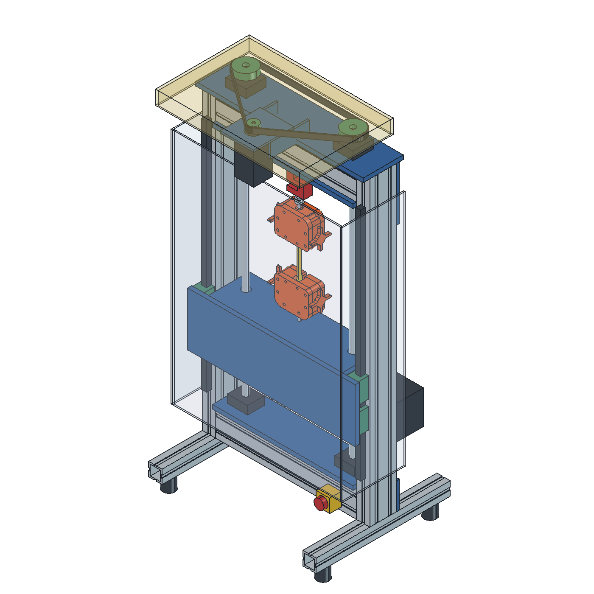

# Open-Pull Profile v0.1.0-design

**출력 인장 시편 비교용 · 구매/제작 전 검토 CAD · 실물 내하중 미검증**

**전체 검증 판정: 현재 도면 그대로 발주·조립 보류.** [실제 구매 옵션과 치수 불일치 검증](ASSEMBLY_AUDIT.ko.md)에 근거와 다음 수정 사항을 정리했다.

CNC Kitchen [Open-Pull](https://github.com/CNCKitchen/Open-Pull)을 기반으로 목재 프레임을 4080 알루미늄 프로파일로 재설계했다. 원본 STEP의 상·하 그립 형상을 실제로 가져오고, 두 나사 구동·로드셀 측정 방식을 계승했다. 원본 Arduino/CAD/문서는 보존돼 있다. 새 구동은 SFU1605 두 개와 단일 NEMA23의 벨트 동기화를 제안한다.



## 바로 열기

- [FreeCAD 조립체](cad/OpenPull_Profile_v0.1.0-design.FCStd)
- [STEP](cad/OpenPull_Profile_v0.1.0-design.step)
- [정면](renders/front.png) / [측면](renders/right.png)
- [구매 후보·가격 상태](SOURCING.ko.md) / [부품표 CSV](BOM.csv)
- [발주·조립 가능성 검증](ASSEMBLY_AUDIT.ko.md)
- [프로파일 절단 목록](CUT_LIST.csv) / [판재 블랭크 목록](PLATE_LIST.csv)
- [설계 기준](../docs/superpowers/specs/2026-10-24-profile-frame-design.md)
- [기하 검증 결과](VALIDATION.json) / [개발 기록](DEVELOPMENT_LOG.md)
- [파일 재열기·STEP 교환·CI 확인](FINAL_VERIFICATION.json)

전체 외형 약 **510×415×1067mm**. 4080 기둥 900mm×2, 4080 가로보 420mm×4, 4040 발 400mm×2. 연구 목표는 2kN, 로드셀 후보는 500kgf지만 **장비 정격이 아니다**. 원본 큰 시편은 위치 참조로 표시했고, 첫 재료 비교에는 단면이 작은 시편을 제안한다. 예: 5×2mm에서 응력60MPa라면 하중600N.

## 수정과 재생성

FreeCAD 1.1에서 `build_profile.FCMacro`를 열어 실행한다. 입력은 옆의 `config.json`이다. 새 문서를 만들고 FCStd/STEP/그림/프로파일 절단표를 저장한다. FreeCAD의 Parameters 시트는 입력값을 보여주는 기록이며 시트 편집으로 형상이 자동 갱신되지는 않는다. **JSON을 수정한 후 매크로를 재실행**한다. 기존 모델 파일은 재생성 시 대체되므로 변경 전 커밋한다.

FreeCAD Python 콘솔에서 기하 검증 실행:

```python
import runpy
runpy.run_path('/absolute/path/to/Open-Pull/profile/../tests/test_profile_geometry.py', run_name='__main__')
```

`test_profile_geometry.py`는 FreeCAD Python이 필요하다. `python profile/check_release.py`는 일반 Python으로 파일·해시·버전 일관성과 원본 보존을 검사한다. CAD를 바꾼 뒤 기하 검증과 해시 생성까지 다시 실행해야 한다.

## 제작 전에 해결할 항목

1. 판매자 도면으로 나사 끝단·BK/BF 지지대·레일·센서 탭·홈 너트 규격 확정. 현재 구매품은 외형 공간 모델이다.
2. 판재·프로파일 체결과 가공 공차 확정. 큰 판은 AL6061-T6 후보, 핀·나사·그립 전환 어댑터는 강재 후보다. 단순화 프로파일로 구조해석을 대신하지 않는다.
3. 원본 출력 그립의 미끄러짐과 내하중 확인 또는 금속 그립 교체. CAD의 주황색은 원본 형상이며 금속으로 검증된 그립이 아니다.
4. 볼스크류 역구동에 대한 낙하 방지, NC 리미트, 비상정지/전원 차단과 포획장치, 접지·퓨즈·차폐 확정.
5. 새 구동계의 펌웨어/드라이버/센서 교정. 원본 펌웨어는 새 2:1·5mm 구동에 검증되지 않았다. 8마이크로스텝 가정은 640step/mm.
6. 무부하·단계별 하중·변위 교정과 반복성 확인. 탄성률을 구하려면 별도의 표점 추적이 필요하다.

## 버전 관리

원본 기준 SHA는 [UPSTREAM.md](../UPSTREAM.md), 변경 내역은 [CHANGELOG.md](../CHANGELOG.md)에 기록한다. 작업 브랜치는 `codex/profile-frame-v0.1`, 버전은 `0.1.0-design`이다. native CAD, STEP, 설정, 매크로, 부품표와 검증을 한 버전에 묶는다. 게시 시 `v0.1.0-design` 태그로 고정하며 기존 태그를 덮어쓰지 않는다. 실물 검증과 구매 규격 확정은 다음 버전의 별도 변경으로 남긴다.

원본 저작자 Stefan Hermann / CNC Kitchen, GPL-3.0. 이 포크는 CNC Kitchen의 공식 개정판이나 보증을 뜻하지 않는다.
