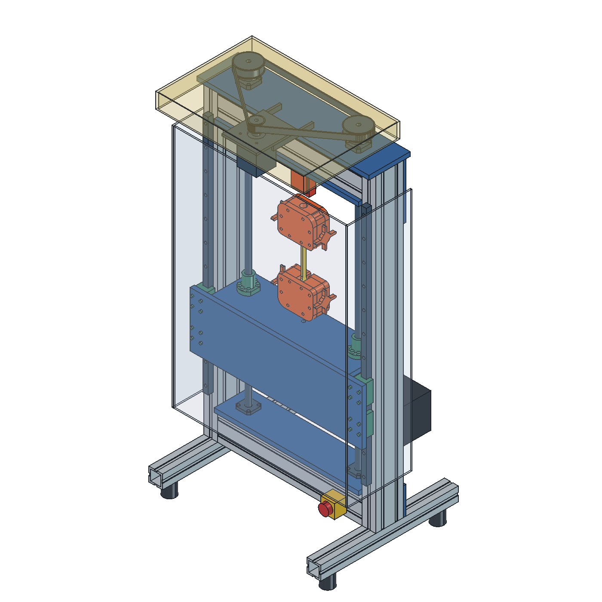

# v0.2 국내 판매품 도면 대조

**버전: 0.2.0-interface-review / 발주·가공·가동 보류.** 전 부품이 연결된 제작 완료 조립체가 아니다. 제조사 도면으로 구동부와 가이드 체결부를 바로잡은 검토 버전이다. v0.1.0-design 태그와 원본 CNC Kitchen 파일은 보존한다.

- [국내 판매·미스미·쿠팡 비교](SOURCING.ko.md)
- [부품 품번과 도면 출처](PARTS.json), [검증 기록](VALIDATION.json)
- [FreeCAD 조립체](cad/OpenPull_Profile_v0.2.0-interface-review.FCStd), [STEP](cad/OpenPull_Profile_v0.2.0-interface-review.step)
- [모터/구동계 상세 조사](MOTOR_DRIVE.md), [나사/가이드](SCREWS_GUIDES.md), [센서/그립](SENSOR_GRIPS.md)

## 무엇을 실제 치수로 바꿨는가

| 부분 | 이번 변경 | 정확도의 범위 |
|---|---|---|
| 모터 | Leadshine57CM23-3A, 57.2 최대각×76.5, 축8×21/D컷, 파일럿38.1×1.6, 47.14 정사각 홀 패턴 | 2021 제조사 PDF로 재구성. 내부·몸체 모서리는 최대 외형. 제조사 3A ZIP 안의 4A STEP을 3A로 바꾸어 쓰지 않음 |
| 볼스크루 | C-TBSE1505-861, 실제16mm/리드5, 지지단10·베어링단12·M12×1·구동단10×15, 링 홈 | 전체861. 헬릭스 생략. 900mm 기존 배치는 지지대 간격에 안 맞음 |
| 지지대 | C-TFK12/C-TFF12 보스·플랜지·PCD·4홀·카운터보어, 판의 대응 구멍 | FK992/FF172 설치면은 도면 치수와 칼라에서 **계산한 좌표**, 독립 STEP/실물 대조 보류 |
| 볼너트 | 실제42mm 길이, 몸체28, 플랜지48/폭40/두께10, 6×5.5 PCD38, M5 볼트 | 기존 가상 사각 너트하우징 제거. 플랜지를 이동판 윗면에 직접 장착. 그리스 니플 세부 형상 생략 |
| 가이드 | E-HLGH15-700-B2×2, 4블록, 높이28/블록58.4, 26×26 M4깊이5, 레일12홀/P60/E20 | 레일 설치면Y−40 → 블록 체결면Y−68. 이동판 두께12에 M4×16 사용 시 물림4mm |
| 벨트/풀리 | 국내 미스미 S5M20/40T, P8/P10, 920×15 | 외형·축 구멍·벨트 피치 경로. 치형/고정나사 전달 토크/오버행 검증 아님 |
| 센서/그립 | CAS SBA51×76×19/커버27, 원본 그립 Ø17×22 확인 | 센서 나사깊이/포트 오프셋은 미치수화. **틀린 M8 연결봉을 삭제했으며, 센서와 그립 사이 하중 경로는 열려 있음** |

## 남은 제작 보류 조건

1. 프레임 단면과 홈 규격 결정. CAD의 프로파일은 v0.1 개념 단면이며 **미스미 HFS8 또는 쿠팡 판매품의 정확한 단면이 아니다**. HFS8의 홈 폭10mm와 40mm 피치에 맞는 너트/브래킷 일괄 선정, 레일 설치면 가공·심 조정, 프레임 모든 체결부·공구 접근·구조 검토가 필요하다.
2. 풀리 축 체결. 볼스크루 꼬리는15mm이고 풀리는 총34/허브12mm다. 치면이 축 밖으로 나가므로 단순 끼워 넣은 그림을 전달 토크 검증으로 볼 수 없다. 클램핑/중간축/축끝 재가공 중 실제 제조사 허용 경로를 정한다. 모터 고정 볼트·너트·후면 접근, 장력 조절 슬롯도 확정 전이다.
   현재 삼각 벨트 경로의 모터 감김각은 계산상72.50°, 맞물리는 이는 약4.03개다. 920mm 길이가 닫힌다는 검사만으로 전달 용량을 보증하지 않는다. [Mitsuboshi 설계 매뉴얼](https://global.mitsuboshi.com/assetFiles/timing_belt_design_manual_en.pdf) 인쇄2-20/2-27쪽은 이물림 수에 따른 정격 보정을 안내한다. 실제 미스미 벨트 제조사 기준으로 보정/수명·장력·축 하중을 계산하거나 아이들러/구동 경로를 다시 설계해야 한다. 다른 브랜드의 보정계수를 이 부품 정격으로 단정하지 않는다.
3. FK의 허용 축하중과 계산 설치 좌표 확인. 2kN 목표를 두 축에 나눈다고 정격이 생기지 않는다.
4. CAS 탭 유효깊이와 그립 금속 어댑터 설계. 기존 원본 구멍을 M8/M16 나사로 단정하지 않는다. 로드엔드/핀/클레비스는 치수 검토 후보이며 아직 이 CAD에 완성 연결품으로 배치하지 않았다. 센서는 외형만 모델링했다.
5. 역구동 포획/브레이크, 가드 고정·힌지·래치, 전기 도면·비상정지·리미트, 원본 펌웨어의 속도/스텝/하중 차단 재설계. 전장품은 공간 배치만 남아 있으며 국내 확정 전장 BOM이 아니다.

## 검사 및 재현

FreeCAD Python에서 `runpy.run_path('.../profile/domestic-v0.2/build_domestic.FCMacro')['build'](repository_root)`로 생성하고 `runpy.run_path('.../tests/test_domestic_interfaces.py')['run']()`으로 확인한다. JSON의 부품값을 바꾸기만 하면 CAD가 자동 갱신되는 구조는 아니다. 변경 시 생성기의 대응 치수와 독립 검사 기대값을 함께 검토한다.

검사는 형상 유효성, 선택된 장착 구멍/지지단/체결면, 이동부 대 고정부 간섭을 0~−100mm 10mm 간격으로 확인한다. 연속 운동·치형 맞물림·공구 접근·전 부품간 접촉·응력·내구·실물 정확도 검사는 아니다. 원본 그립과 센서가 연결되지 않은 상태이므로 **assembly_ready=false, load_path_complete=false**를 유지한다.
