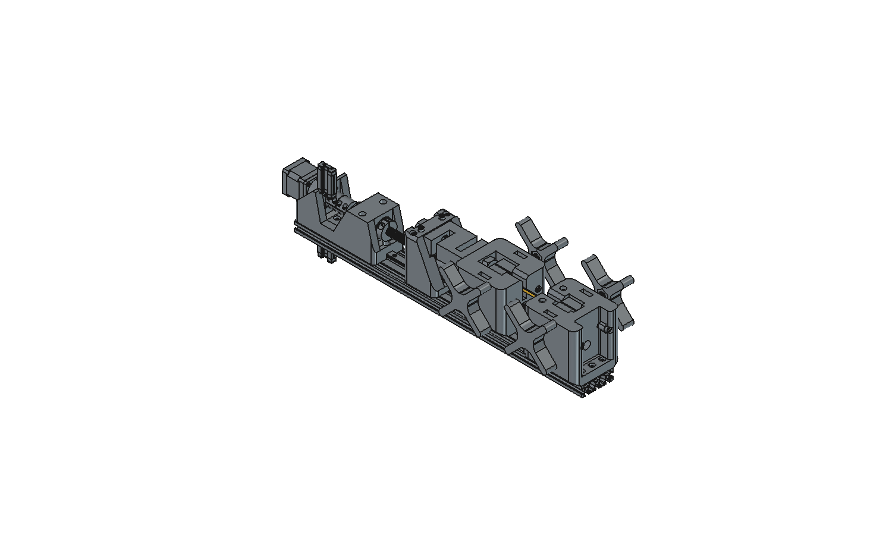

# v0.4 — UTM V2·MT02·상온 엔지니어링 시험 검토

최신 조건은 **출력비 제외 권장60만원 / 최대80만원 미만**이다.
[견적](QUOTE.ko.md): 권장589,084원,강화789,084원. 공개가 외에 배송·세금·가공·반력부 충당금과 예비비를 포함한 개발 예산이며 확정 발주가/조립 완성품이 아니다. 강화안의 최소2kN는 여전히 검증할 목표다.

- [UTM 파생 PETG·축소 엔지니어링 비교 배치](utm-derived/UTM_V2_budget_fixture_study.FCStd): 원형142솔리드와 맞춤 시편2대안. 실제 원형 부품이지만 견적 대체 모터/센서 실도면 반영은 미완료. [출처·라이선스 경계](THIRD_PARTY.md).
- [MT02 재구성](cad/MT02_source_derived_layout.FCStd): 논문 기반56솔리드, 원본 CAD가 아님. 프로파일 홀 간격·너트 탭 규격 등 원문 충돌을 기록했다.
- [10kN 엔지니어링 확장](cad/Engineering_10kN_room_temperature_study.FCStd): 강재 프레임,금속 그립,CAS2t 센서 외형,스크루/지지/광학 계측 자리54솔리드. 지지부/접합/실구동/교정 미완료이며 현 예산 밖의 요구조건 검토다.
- [STEP3개](STEP_exchange.zip),[선택 기하 검증](NATIVE_CHECK.json),[교환 검증](EXCHANGE_CHECK.json),[설계 입력](DESIGN_INPUTS.json).

UTM의 PETG 맞춤 시편은150×20외곽,중앙5×2mm(10mm²);엔지니어링 맞춤은중앙2×2mm(4mm²)다. 형상은 사용자 소재/출력조건 **비교용 제안**이며 ISO527 규격 시편으로 검증하지 않았다. 두 시편은 겹치는 대안이어서 FreeCAD에서는 PETG만 표시,STEP에는 PETG만 포함했다. 전체10×4mm ISO 유사 시편과 같은 결과로 혼합하지 않는다.

## 근거 자료

- [UTM 원형·가격·조립 누락](research/utm-v2.md),[BOM](research/utm-v2-bom.json),[최신60/80만원 독립검토](research/budget600-review.md).
- [MT02 논문·도면·가격 검토](research/mt02.md),[원본 BOM 추출/구매 후보](research/mt02-bom.json).
- [ISO 검토](research/iso.md),[엔지니어링/상온 추가 조건](research/engineering-iso-addendum.md).
- [소재TDS/단면별 요구하중](research/engineering-filament-envelope.md),[10kN 구동·축지지·센서 견적](research/10kn-upgrade-budget.md).

조사 기록의500,000원은 이전 제약이다. 현재 견적은CURRENT_QUOTE.json과QUOTE.ko.md가 우선한다. 알리 선택 판매자·한국 결제가는 미확인이다. 물리적 하중 시험/전체 조립 검증/ISO 적합성은 모두 미확립이다.

ISO527-2는2025판이며 정확한 현행 시편 치수/공차 전체 표를 확보하지 못했다. 기본10×4mm 단면에 대한 강도 범위 계산과 명목 시편 파일은 규격 적합성 증거가 아니다. 강도 비교,신율,탄성률의 측정 요구를 구분하며 크로스헤드 이동량을 교정 신율계로 취급하지 않는다. 상온23°C부터 시작하고 PA6계 함수율·건조·방향·열처리 조건을 함께 기록한다.

## 저장/재생성

FreeCAD에서 `build_studies.FCMacro`의build(root,False/True)를 실행한다. 예산 배치는 `build_budget_fixture.FCMacro`의build(root,source_native)를 실행하며,source_native는 출처 STEP를 가져와 저장한 원형 FCStd다. 원형 대형STEP 자체는 재배포하지 않았고 출처/해시를THIRD_PARTY.md에 기록했다. 모든 모델은 프레임/복사 직후 및 완료 후 저장했다.

테스트는 모델 형상과 선택 간섭/파일 무결성만 확인한다. 특히 UTM 죠 두께 조절 후 손잡이·나사 재체결,대체 모터/센서 장착,모든 하중 연결부/반력/차폐·전장 검증은 남아 있다. 구매·가공용 릴리스로 사용하지 않는다.

교환 검증: 세 네이티브 파일을 디스크에서 다시 열고 STEP의 유효 솔리드/합산 체적을 비교했다. 자체 재구성 두 모델의 체적 상대 차이는2.52e-9/1.44e-10,복잡한 원형 유래 UTM은4.25e-6(약0.000425%)다. UTM은 가져온 스플라인 형상의 재출력 수치 차이를 허용한1e-5 기준으로 확인했으며 완전히 동일한 형상이라는 뜻은 아니다. 교환 파일에는 UTM143솔리드(PETG 대안1개 포함),MT0256개,10kN54개가 들어 있다. 독립 검토에서 찾은 우측 죠 이동방향 오류를 수정했고,저장 네이티브와 기하 검사에서 양쪽 간격2mm를 확인했다.
